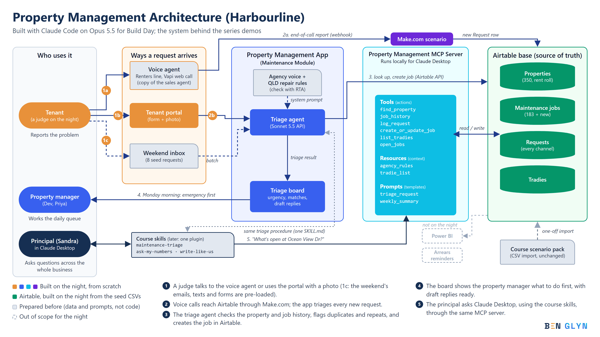

# Harbourline Maintenance Desk

An AI maintenance desk for a small property manager. Requests arrive by web portal, voice call, email and text; Claude triages each one against the agency's records, puts the gas leak above the dripping tap, and drafts the replies. A person approves every message: nothing is sent automatically.

Built in one evening with Claude Code (Opus 5.5) for the Brisbane Opus 5.5 Build Day, 13 October 2026, by [Ben Glyn](https://benglyn.com). Harbourline Property Management and all its data are fictional.

## What it does

| Page | What it does |
|---|---|
| **Portal** (`/portal`) | Tenants report a problem with an address, a description and an optional photo. The request is triaged straight away and the drafted reply is shown. Photos are shrunk in the browser and sent only to Claude; only a one-line description is saved |
| **Talk to Jane** (`/talk`) | A browser voice call with Jane, a Vapi voice agent, with a live transcript and a two-sentence summary. Make.com logs each call to Airtable |
| **Triage board** (`/board`) | Every request, Emergency first. Each card shows urgency, flags (call back, duplicate, repeat fault, landlord approval), the issue, the next step and, under Details, the tenant reply, work order and things to confirm. Filters by urgency, flags, date and address. It also triages any voice call still marked New |
| **Architecture** (`/architecture`) | The system diagram and a skills map |
| **Guide** and **Demo** (`/guide`, `/demo`) | Test steps for each component and demo run sheets |
| **MCP server** (`mcp/`) | Lets Claude Desktop answer questions across the business ("What's still open at 69 Lakeside Ct?") from the same Airtable data |

### How triage works

Triage is a workflow, not an open-ended agent loop:

1. **Code looks up** the property from the address, its full job history, its recent requests and the tradie list.
2. **Code applies hard rules:** an address that matches no property, or several, gets a call back (it never guesses); only listed tradies; over 500 dollars needs landlord approval.
3. **One Claude call** (Sonnet 5.5, low effort, JSON schema output) with the request, any photo and all the looked-up data. System prompt: [triage-procedure.md](triage-procedure.md) plus [qld-repair-rules.md](qld-repair-rules.md).
4. **Code saves** the result to the request and marks it Triaged.

`npm run check` loads the 8 sample requests in `seed/inbox/`, triages them one at a time and asserts the answer key in code (gas leak first, the duplicate, the repeat fault, the "unit 8" that needs a call back, and more). No AI judge.

## Stack

Next.js 16 (App Router, TypeScript, Tailwind), the Anthropic TypeScript SDK, Airtable (REST), Vapi (voice), Make.com (voice calls into Airtable), and a Python MCP server (official `mcp` SDK, stdio). It runs on localhost.

## Run it yourself

You need: Node 20+, Python 3.11+, an Anthropic API key and an Airtable account. Vapi and Make.com are only needed for the voice channel.

1. **Install:** `npm install`
2. **Settings:** copy [.env.example](.env.example) to `.env.local` and fill it in. Never commit `.env.local`.
3. **Airtable:** build the base and load `seed/` as described in [docs/airtable-schema.md](docs/airtable-schema.md). Put the base ID in `.env.local`.
4. **Start:** `npm run dev`, then open http://localhost:3000.
5. **Check triage:** `npm run check` should pass every row.
6. **Voice (optional):** set up the Vapi assistant from [docs/voice-agent-prompt.md](docs/voice-agent-prompt.md), then a Make.com scenario (Custom webhook, filter on `end-of-call-report`, Airtable create record in Requests) mapped as in [CLAUDE.md](CLAUDE.md) under "Make.com and Vapi". Point the assistant's Server URL at the webhook.
7. **Claude Desktop (optional):** in `mcp/`, create a venv and `pip install -r requirements.txt`. Add a server named `harbourline` to Claude Desktop's `claude_desktop_config.json`, with the venv's full `python` path as the command and `server.py` as the argument. It reads `../.env.local`. Quit and reopen Claude Desktop.

[CLAUDE.md](CLAUDE.md) is the full build spec that Claude Code followed. It's a good place to start if you want to build your own version with Claude Code.

## Licence

[MIT](LICENSE). Use it, adapt it, build on it.
